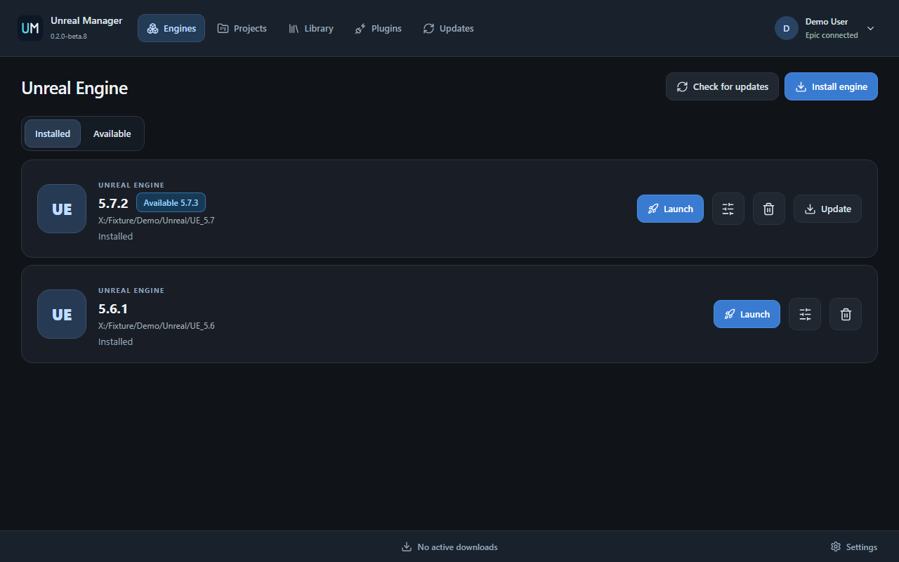

# Unreal Manager

An independent, lightweight Unreal Engine manager for **Windows x64**.
Manage engines, projects, Fab assets, Vault content and plugins in one desktop
application, without a game storefront.

**Version 0.9.2.** Download the installer or portable edition, or build from source.
See the [0.9.2 change notes](source/CHANGELOG.md).

[Website & screenshots](https://merrygrim.github.io/UnrealManager/) ·
[Build instructions](source/README.md) · [Verification](verification/README.md) ·
[MIT license](LICENSE) · [Third-party notices](THIRD_PARTY_NOTICES.md)

Website languages: [Русский](https://merrygrim.github.io/UnrealManager/?lang=ru),
[English](https://merrygrim.github.io/UnrealManager/?lang=en),
[Deutsch](https://merrygrim.github.io/UnrealManager/?lang=de),
[Italiano](https://merrygrim.github.io/UnrealManager/?lang=it),
[Español](https://merrygrim.github.io/UnrealManager/?lang=es),
[Français](https://merrygrim.github.io/UnrealManager/?lang=fr),
[简体中文](https://merrygrim.github.io/UnrealManager/?lang=zh),
[日本語](https://merrygrim.github.io/UnrealManager/?lang=ja),
[한국어](https://merrygrim.github.io/UnrealManager/?lang=ko).



## Features

- Discover installed Unreal Engine versions and local `.uproject` files.
- Launch projects through their Windows association and manage engine associations.
- Sign in through Epic's website; browse the Fab library and redeem keys.
- Install, verify, modify or remove engines with component selection.
- Faster installed-file checks with bounded, storage-aware reading and visible
  fractional progress, files per second, read bytes and the current file.
- Bounded old/new file checks while applying updates, with progress inside the
  current file and responsive pause checkpoints. Replacements retain content
  verification and recovery journals.
- Manage local Vault storage and connect an existing Epic VaultCache.
- Download and install assets, projects and plugins; inspect update conflicts.
- Pause downloads, resume through HTTP Range, and restore saved tasks after restart.
  Continuing a saved task is initiated by the user.
- Queue asset downloads to Vault with one active transfer. Reorder waiting items
  by dragging or using the keyboard controls. Restored queues wait for an explicit
  start; project copying remains a separate action.
- Download history, tray behavior, speed and storage settings, and nine interface
  languages: Russian, English, German, Italian, Spanish, French, Simplified Chinese,
  Japanese and Korean.
- Settings grouped into Interface, Downloads, Storage, Projects and App updates.

Real-account checks covered Fab downloads, pause/restart/resume, queued downloads,
priority ordering, project copying, engine installation and Editor launch, and
removal of the test installation. These checks cover specific builds and a tested
Windows environment; clean-Windows setup and every Epic/Fab scenario remain
outside that acceptance scope. Website screenshots use fictional demonstration data.
GitHub application updates support installed and portable editions. **Settings → App updates** offers
stable/beta channels, a startup check at most daily, manual checks, verified downloads
and apply with restart. No update service or permanent helper is installed.
See [updater and release details](source/UPDATES.md).

## Lightweight rendering

The React/TypeScript interface and Rust backend are packaged with Tauri. All
WebView2 windows, including Epic login and redemption, are configured with
`--disable-gpu --disable-gpu-compositing` before creation. There are no WebGL
effects, animated canvases or continuous decorative rendering loops.

Software-rendering configuration is distinct from measured GPU activity on a
particular machine. See the [runtime measurement procedure](verification/README.md).
Windows desktop composition is outside the application's rendering policy.

## Download 0.9.2

[Windows x64 installer](https://github.com/MerryGrim/UnrealManager/releases/download/v0.9.2/UnrealManager-0.9.2-Windows-x64-Setup.exe) ·
[Portable ZIP](https://github.com/MerryGrim/UnrealManager/releases/download/v0.9.2/UnrealManager-0.9.2-Windows-x64-Portable.zip) ·
[Release notes and checksums](https://github.com/MerryGrim/UnrealManager/releases/tag/v0.9.2)

The installer installs for the current user. For portable use, extract the ZIP to
a writable directory and keep `portable.marker` beside `unreal-manager.exe`.
Both editions require Microsoft WebView2 Runtime; the installer can install it
when missing. The portable edition stores its data in the adjacent `Data` folder.

## Build from source

The application requires Windows 10/11 x64 and Microsoft WebView2 Runtime.
Development tools are only required for building and testing; they are not
runtime requirements.

Install Node.js 22.12+ (or 24 LTS), Rust stable with the MSVC toolchain, and
Microsoft C++ Build Tools with a Windows SDK. Then run in PowerShell:

```powershell
git clone https://github.com/MerryGrim/UnrealManager.git
cd UnrealManager/source
.\BUILD-WINDOWS.ps1 -Configuration release
.\PACKAGE-PORTABLE.ps1
```

Outputs go to `Releases/<version>` and `source/src-tauri/target`. The portable
package stores its data beside the executable in `Data` when `portable.marker`
is present. See [source/README.md](source/README.md) for environment configuration,
installer prerequisites and commands. Inno Setup 7 builds the installable version;
the official Microsoft WebView2 bootstrapper must be obtained separately.

## Repository layout

| Path | Contents |
| --- | --- |
| `source/src` | React interface and translation catalogues |
| `source/src-tauri/src` | Rust backend, storage and Epic/Fab integration |
| `source/installer` | Inno Setup source and packaging instructions |
| `verification` | UI regression scripts and native measurement tooling |
| `docs` | Buildless GitHub Pages site with nine languages and two themes |

User data, account sessions, content, development caches, historical conversations,
local verification results and binary archives are excluded from version control.

## License

Original code, documentation and neutral UM artwork are released under the
[MIT license](LICENSE). Third-party components retain their own licenses;
see [THIRD_PARTY_NOTICES.md](THIRD_PARTY_NOTICES.md) and the application's About tab.

Unreal Engine, Epic Games and Fab are marks of their respective owners. This
project is independent and is not affiliated with or endorsed by Epic Games.
